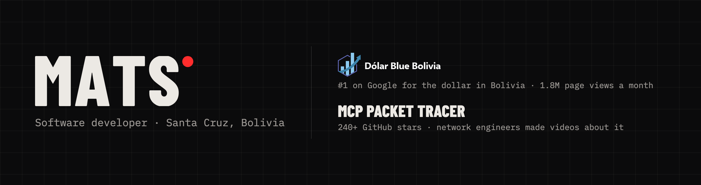

<a href="https://matsoto.dev">
  <picture>
    <source media="(prefers-color-scheme: dark)" srcset="assets/header-dark.png" />
    <source media="(prefers-color-scheme: light)" srcset="assets/header-light.png" />
    
  </picture>
</a>

I'm **Mateo Soto Gareca**, a software developer in Santa Cruz, Bolivia, studying Systems Engineering at UPSA.

I build websites, APIs and tools, and then I keep running them: I deploy them, fix them when they break and write down what happened. AI is part of how I work: agents that code alongside me and, when the problem calls for it, part of the product.

**Open to internships and junior roles.** [matsoto.dev](https://matsoto.dev) · [LinkedIn](https://www.linkedin.com/in/mateo-andres-soto-gareca/) · mateoandres2208@gmail.com

---

### What I've built

**[MCP Packet Tracer](https://github.com/Mats2208/MCP-Packet-Tracer)** · [mcpnetwork.top](https://www.mcpnetwork.top/) &nbsp; 
Describe a network in plain language and it is designed, checked and wired inside Cisco Packet Tracer while you watch. 61 tools, 74 device models, live deploy. Network engineers made videos about it: [Simone Spinedi](https://www.youtube.com/watch?v=daJhmwXAKEI) (ABN AMRO Clearing Bank) and [Ryan's Routing Table](https://www.youtube.com/watch?v=_dhgNZWzLPA). 
`Python` `MCP` `Pydantic`

**Dólar Blue Bolivia** 
The real exchange rate in Bolivia, from twelve sources every minute. First result on Google for "dolar blue bolivia", 1.8M page views a month on average, a public API other sites build on, and sponsors since 2025. I built it and I run it alone. 
`Astro` `Python` `React Native` `Tailwind`

**[packetsmith](https://github.com/Mats2208/packetsmith)** · [npm](https://www.npmjs.com/package/packetsmith) 
The terminal client for MCP Packet Tracer: the topology draws itself beside the conversation, from real tool results, so it can't show a device the model only claims it made. 
`TypeScript` `Bun` `OpenTUI`

**[hyprdesk](https://github.com/HyprDesk/hyprdesk)** · [site](https://hyprdesk.github.io/hyprdesk/) 
One agent plans, the rest build in parallel, each on its own git worktree, on your own machine. Four workers built its landing page in 75 minutes. 
`Rust` `Tauri v2` `React`

**Sociedad Cruceña de Pediatría** · [scpediatria.com](https://scpediatria.com) 
The public site of a medical society founded in 1965, and the panel its office uses to publish events without touching code. In production. 
`.NET` `PostgreSQL` `Astro`

More: [ScanToSketchUp](https://github.com/Mats2208/ScanToSketchUp) (iPhone LiDAR to SketchUp) · [Audio-Transcriber-STT](https://github.com/Mats2208/Audio-Transcriber-STT) (local transcription on your GPU) · [FESTCINE](https://github.com/Mats2208/FESTCINE) (business logic in SQL Server) · [DownloadYoutubeTool](https://github.com/Mats2208/DownloadYoutubeTool) (native macOS) · an accepted [pull request to lian-li-linux](https://github.com/sgtaziz/lian-li-linux/pull/152) (+1,191 lines).

---

### Tools I ship with

**Languages** · Python · TypeScript · C# · Swift · Rust · SQL 
**Frameworks** · Astro · React · FastAPI · .NET · Tauri · SwiftUI 
**Data and ops** · PostgreSQL · SQL Server · Docker · Linux · nginx · Git

Every name here is one I've shipped something with.
