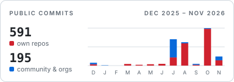

<a href="https://matsoto.dev">
  <picture>
    <source media="(prefers-color-scheme: dark)" srcset="assets/header-dark.png" />
    <source media="(prefers-color-scheme: light)" srcset="assets/header-light.png" />
    
  </picture>
</a>

**I'm Mateo Soto Gareca, a software developer in Santa Cruz, Bolivia.** I study Systems Engineering at UPSA and build tools that let AI agents drive real software: Packet Tracer, SketchUp, Blender, a GPU. I also ship and run websites and APIs, and I keep them up.

**Open to internships and junior roles.** [Portfolio](https://matsoto.dev) · [LinkedIn](https://www.linkedin.com/in/mateo-andres-soto-gareca/) · [Email](mailto:mateoandres2208@gmail.com)

## Flagship

  
  

**[MCP Packet Tracer](https://github.com/Mats2208/MCP-Packet-Tracer)** · Describe a network in plain language and it gets designed, validated and wired inside Cisco Packet Tracer. 405 stars and 30 forks; network engineers [Simone Spinedi](https://www.youtube.com/watch?v=daJhmwXAKEI) and [Ryan's Routing Table](https://www.youtube.com/watch?v=_dhgNZWzLPA) made videos about it. [Site](https://www.mcpnetwork.top/) · [Case study](https://matsoto.dev/work/mcp-packet-tracer)

**[Dólar Blue Bolivia](https://www.dolarbluebolivia.click)** · Bolivia's parallel exchange-rate tracker, built and run by me. It pulls from 12 sources every minute and serves a public API other sites use. **1.8M monthly page views** on average from September 2025 to August 2026. [Case study and traffic data](https://matsoto.dev/work/dolar-blue-bolivia)

## Recent work

<table>
<tr>
<td width="50%" valign="top">

 <strong><a href="https://github.com/Mats2208/qwen-image-local">Qwen Image Local</a></strong> 
Type a prompt or drop up to 10 photos and Qwen-Image-2.1 renders it on a 12 GB GPU in about 35 s. Desktop app and CLI, with an honest benchmark against gpt-image-2. 15 stars, 15 forks.
</td>
<td width="50%" valign="top">

 <strong><a href="https://github.com/Mats2208/plomada-sketchup-mcp">Plomada</a></strong> 
Tell your AI "build this plan in SketchUp": any CAD plan, DWG or prompt comes out as the exact building, with manifold walls, real openings and one Ctrl+Z.
</td>
</tr>
<tr>
<td width="50%" valign="top">

 <strong><a href="https://github.com/Mats2208/voxel-factory">Voxel Factory</a></strong> 
Ask your agent for "a robot and a cat arguing over the keyboard" and get back a vertical MP4 with 3D voxel characters, voices, lip sync and subtitles, rendered in Blender.
</td>
<td width="50%" valign="top">

 <strong><a href="https://github.com/Mats2208/studio-motion-v2">Studio Motion v2</a></strong> 
Swap the voice-over and the whole ad re-times itself: every word, cut and 2D↔3D match lands on the voice. 8 Blender shots, 4 voices, 0 3D re-renders.
</td>
</tr>
</table>

## More projects

- **[HyprDesk](https://github.com/HyprDesk/hyprdesk)** · One agent plans while the others work in parallel, each in its own Git worktree. Four workers built its landing page in 75 minutes.
- **[PacketSmith](https://github.com/Mats2208/packetsmith)** · Terminal client for MCP Packet Tracer that draws the topology beside the conversation. [npm](https://www.npmjs.com/package/packetsmith)
- **[Sociedad Cruceña de Pediatría](https://scpediatria.com)** · Public website and admin panel for a medical society, in production with Astro, .NET and PostgreSQL.
- **[Audio Transcriber STT](https://github.com/Mats2208/Audio-Transcriber-STT)** · Audio, video or YouTube to transcript, notes and Q&A, with faster-whisper on your own GPU.
- **[ScanToSketchUp](https://github.com/Mats2208/ScanToSketchUp)** · Scan a room with an iPhone and get editable geometry in SketchUp.
- **[DeriBot](https://derivabot.matsoto.dev)** and **[EDOLab](https://github.com/Mats2208/EDO-FRONTEND)** · Math tutors from university: step-by-step multivariable derivatives, and ODEs solved with Euler and RK4.
- **[lian-li-linux #152](https://github.com/sgtaziz/lian-li-linux/pull/152)** · Merged contribution to an open-source Linux fan and RGB controller.

**Stack** · Python · TypeScript · C# · Swift · Rust · SQL · Astro · React · FastAPI · .NET · Tauri · PostgreSQL · Docker · Linux

## GitHub activity

  
  

  <a href="https://gitranks.com/profile/Mats2208">
    <picture>
      <source media="(prefers-color-scheme: dark)" srcset="https://gitranks.com/badge/user/Mats2208/count-chart.svg?theme=dark">
      
    </picture>
  </a>

  

