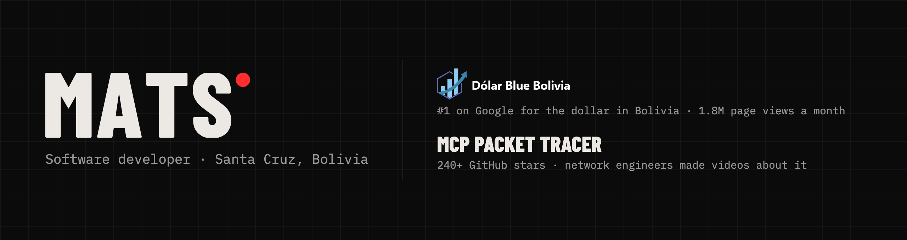

<a href="https://matsoto.dev">
  <picture>
    <source media="(prefers-color-scheme: dark)" srcset="assets/header-dark.png" />
    <source media="(prefers-color-scheme: light)" srcset="assets/header-light.png" />
    
  </picture>
</a>

**I'm Mateo Soto Gareca, a software developer in Santa Cruz, Bolivia.** I study Systems Engineering at UPSA and build websites, APIs, and tools. I keep them running, too. I deploy them, fix what breaks, and write down what happened.

**Open to internships and junior roles.** [Portfolio](https://matsoto.dev) · [LinkedIn](https://www.linkedin.com/in/mateo-andres-soto-gareca/) · [Email](mailto:mateoandres2208@gmail.com)

## What I've built

  
  

### [MCP Packet Tracer](https://github.com/Mats2208/MCP-Packet-Tracer)

Describe a network in plain language and watch it get designed, validated, and wired inside Cisco Packet Tracer. Network engineers [Simone Spinedi](https://www.youtube.com/watch?v=daJhmwXAKEI) and [Ryan's Routing Table](https://www.youtube.com/watch?v=_dhgNZWzLPA) made videos showing it in action.

 · [Project site](https://www.mcpnetwork.top/) · [Case study](https://matsoto.dev/work/mcp-packet-tracer)

### [Dólar Blue Bolivia](https://www.dolarbluebolivia.click)

I built and run Bolivia's parallel exchange-rate tracker. It pulls from 12 sources every minute and serves a public API that other sites use. The site averaged **1.8M monthly page views** from September 2025 to August 2026.

[Live site](https://www.dolarbluebolivia.click) · [Case study and traffic data](https://matsoto.dev/work/dolar-blue-bolivia)

### More projects

**[PacketSmith](https://github.com/Mats2208/packetsmith)** · A terminal client for MCP Packet Tracer. It draws the topology beside the conversation using the results returned by Packet Tracer. [npm](https://www.npmjs.com/package/packetsmith)

**[HyprDesk](https://github.com/HyprDesk/hyprdesk)** · One agent plans while the others work in parallel, each in its own Git worktree on your machine. Four workers built its landing page in 75 minutes. [Project site](https://hyprdesk.github.io/hyprdesk/)

**[Sociedad Cruceña de Pediatría](https://scpediatria.com)** · I built the society's public website and the admin panel its staff uses to publish events without touching code. In production with Astro, .NET, and PostgreSQL.

More work and tools I ship with

- [ScanToSketchUp](https://github.com/Mats2208/ScanToSketchUp) · iPhone LiDAR scans in SketchUp.
- [Audio Transcriber STT](https://github.com/Mats2208/Audio-Transcriber-STT) · Local transcription on your GPU.
- [FESTCINE](https://github.com/Mats2208/FESTCINE) · Festival management logic in SQL Server.
- [DownloadYoutubeTool](https://github.com/Mats2208/DownloadYoutubeTool) · Native macOS app.
- [lian-li-linux](https://github.com/sgtaziz/lian-li-linux/pull/152) · Merged contribution to an open-source Linux fan and RGB controller.

**Languages** · Python · TypeScript · C# · Swift · Rust · SQL 
**Frameworks** · Astro · React · FastAPI · .NET · Tauri · SwiftUI 
**Data and ops** · PostgreSQL · SQL Server · Docker · Linux · nginx · Git

<h2 align="center">GitHub activity</h2>

   
  

  

